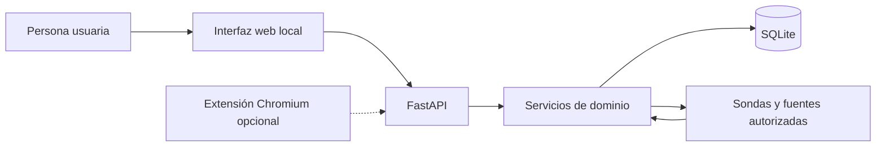

# NetSentinel

### Inventario · Observabilidad · Diagnóstico de redes autorizadas

Una herramienta local para entender qué dispositivos y servicios hay en una red, qué cambió y qué evidencia respalda cada observación.

[Guía de usuario](docs/USER_GUIDE.md) · [Caso de estudio](docs/CASE_STUDY.md) · [Arquitectura](docs/ARCHITECTURE_OVERVIEW.md) · [Seguridad](SECURITY.md)

---

NetSentinel es una aplicación web local para descubrir dispositivos, registrar cambios y comprobar la disponibilidad de servicios. Reúne inventario e historial en un solo panel, conserva los datos en SQLite y ejecuta las búsquedas cuando la persona usuaria las solicita.

Su prioridad es mostrar qué se observó, de dónde procede la información y qué límites tiene cada resultado. **No es un SIEM, NDR, EDR ni un escáner integral de vulnerabilidades.**

> **Estado del proyecto:** desarrollo activo. La aceptación manual integral y la verificación de las reglas de integración de `main` siguen pendientes; todavía no se declara una versión estable. Algunas mejoras se encuentran en Pull Requests y no forman parte de `main` hasta que se integren. Consultá el [estado del proyecto](docs/PROJECT_STATUS.md) y verificá siempre la rama y el commit evaluados.

## Dirección de producto y desarrollo asistido por IA

NetSentinel es un proyecto personal que conduzco como **Product Owner y responsable del producto**. Utilizo IA generativa como apoyo para investigar, diseñar e implementar, pero la dirección y la aceptación no se delegan:

- Defino el problema, los usuarios, el alcance, las prioridades y el roadmap.
- Investigo referencias y evalúo alternativas antes de decidir qué incorporar.
- Guío la implementación con requisitos, reglas de negocio y criterios de aceptación.
- Reviso arquitectura, seguridad, privacidad, integridad de la evidencia y mantenibilidad.
- Pruebo los cambios, contrasto el resultado con lo solicitado y dirijo nuevas iteraciones cuando algo no cumple el estándar esperado.

El criterio central del proyecto —mostrar evidencia, procedencia y límites en vez de presentar inferencias como certezas— también guía esas decisiones de producto.

## Empezar

1. Descargá el repositorio y descomprimilo.
2. Iniciá NetSentinel con `run-windows.bat` en Windows, `run-macos.command` en macOS o `./run.sh` en Linux.
3. Abrí [http://127.0.0.1:8765](http://127.0.0.1:8765) en el navegador.

El primer inicio necesita conexión a Internet para instalar las dependencias que falten. La aplicación queda vinculada a la computadora local; no habilita el acceso remoto a la red. La [guía de usuario](docs/USER_GUIDE.md#instalación-y-primer-inicio) explica la instalación manual y los requisitos.

## Capacidades principales

- **Inventario y descubrimiento:** búsqueda local bajo demanda, acotada a redes privadas compatibles, con procedencia de las observaciones.
- **Historial y topología LAN:** comparación de lecturas guardadas y relaciones basadas en observaciones históricas; no representan tráfico en vivo ni conexiones físicas confirmadas.
- **Monitorización:** comprobaciones configuradas de ping, TCP y HTTP/HTTPS, con historial e incidentes.
- **Herramientas de diagnóstico:** consultas DNS y comprobaciones puntuales de certificados TLS, ejecutadas cuando se solicitan.
- **Actividad y telemetría autorizada:** sesiones temporales por dispositivo, revisión de metadatos CSV/Zeek importados y retención local configurable. No captura tráfico automáticamente ni registra contraseñas.
- **Hallazgos con evidencia:** cambios del inventario e incidentes de monitorización con su procedencia y estado.
- **Mapa de IP públicas:** vista geográfica opcional que requiere una base GeoLite2-City local válida; sus ubicaciones son aproximadas.

**Módulo experimental:** NetSentinel Forense dispone de una página y una primera base de trabajo para casos y evidencias. No constituye una cadena de custodia validada ni autentica por sí solo la identidad del operador. Sus límites están detallados en la [documentación de Forense](docs/FORENSIC_MODE.md).

## Caso de estudio técnico

El [caso de estudio de NetSentinel](docs/CASE_STUDY.md) explica el problema que aborda, las decisiones de diseño, la arquitectura implementada, cómo se verifica y qué limitaciones siguen abiertas.

## Arquitectura

NetSentinel está construido como un **monolito modular**: FastAPI sirve la interfaz y la API local; SQLite conserva los datos; los servicios y repositorios separan las reglas de negocio de la persistencia. La extensión Chromium es un cliente opcional y separado del servidor.

El esquema resume las responsabilidades principales; no implica captura automática de tráfico ni acceso remoto habilitado.

Consultá la [vista general de arquitectura](docs/ARCHITECTURE_OVERVIEW.md) para entender cómo se conectan las partes; el [detalle técnico](docs/ARCHITECTURE.md) explica módulos, límites y contratos. La decisión principal está registrada en [ADR-001](docs/ADR-001-MODULAR-MONOLITH.md).

## Pruebas y calidad

Para ejecutar las pruebas automatizadas:

~~~bash
python -m pip install -e ".[test]"
python -m pytest
~~~

Los resultados de CI se deben asociar siempre al commit que los ejecutó. Las pruebas automatizadas no reemplazan la aceptación manual, la revisión de accesibilidad ni las comprobaciones de instalación y recuperación de datos.

## Documentación

- [Guía de usuario, instalación y pruebas manuales](docs/USER_GUIDE.md)
- [Estado actual y pendientes de aceptación](docs/PROJECT_STATUS.md)
- [Roadmap](docs/ROADMAP.md)
- [Arquitectura](docs/ARCHITECTURE.md) y [decisión de monolito modular](docs/ADR-001-MODULAR-MONOLITH.md)
- [Dirección y alcance del producto](docs/PRODUCT_DIRECTION.md)
- [Investigación y proyectos de referencia](docs/RESEARCH_INDEX.md)
- [Presentación profesional y criterios de portfolio](docs/PORTFOLIO_PRESENTATION.md)
- [Auditoría actual de ramas](docs/BRANCH_AUDIT_2026-11.md) y [snapshot de SHA](docs/BRANCH_SNAPSHOT_2026-11.csv)
- [Guía para desarrolladores](docs/DEVELOPMENT.md)
- [Política de seguridad](SECURITY.md), [guía técnica](docs/SECURITY.md), [configuración de GitHub y protección de `main`](docs/GITHUB_SETUP.md) y [avisos de terceros](THIRD_PARTY_NOTICES.md)
- [Historial de cambios](CHANGELOG.md)

## Licencia

MIT. Los componentes y recursos de terceros mantienen sus propios avisos y licencias; consultá [THIRD_PARTY_NOTICES.md](THIRD_PARTY_NOTICES.md).
