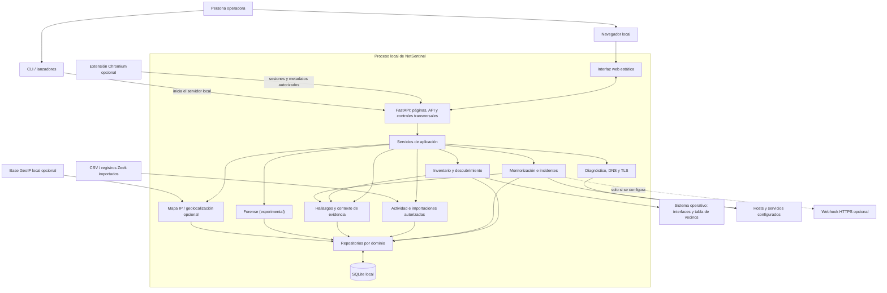

# Vista general de la arquitectura

NetSentinel se instala y ejecuta como **una aplicación local**. FastAPI sirve la interfaz web y la API en loopback; los servicios organizan los casos de uso; los repositorios gestionan las operaciones SQLite. No se despliega como un conjunto de microservicios.

## Diagrama

## Cómo leer el diseño

- **Una instalación, un proceso principal:** la interfaz y la API se sirven localmente. Los módulos internos se llaman mediante servicios Python; no se hacen llamadas HTTP entre módulos del mismo proceso.
- **Responsabilidades separadas:** los routers validan y traducen solicitudes; los servicios coordinan casos de uso; los repositorios poseen las consultas de cada dominio.
- **Persistencia local:** SQLite conserva inventario, observaciones, monitorización y datos importados. Compartir el archivo no significa que cada módulo pueda consultar directamente las tablas de los demás.
- **Fuentes explícitas:** el descubrimiento utiliza datos del sistema operativo y comprobaciones bajo demanda. La actividad externa llega mediante importación o extensión opcional habilitada expresamente; Zeek no se ejecuta dentro de NetSentinel.
- **Integraciones opcionales:** el mapa mundial requiere una base GeoIP instalada localmente. Los avisos por webhook solo se envían si la persona operadora configura un destino HTTPS.
- **Forense experimental:** comparte el marco de API y persistencia, pero no debe interpretarse como un sistema de custodia validado ni como una herramienta forense completa.

## Límites y decisiones

La arquitectura busca mantener simple el despliegue y estrictas las fronteras internas. No hay un broker, clúster, base de datos remota ni plano de control central. Separar módulos en procesos independientes solo se justificaría más adelante por una necesidad demostrada de escalado, aislamiento o despliegue independiente.

El diagrama es una vista conceptual, no un mapa de cada importación o ruta. Para los detalles actuales de composición, repositorios, reglas de dependencias y pruebas de arquitectura, consultá [Arquitectura](ARCHITECTURE.md) y [ADR-001](ADR-001-MODULAR-MONOLITH.md).
